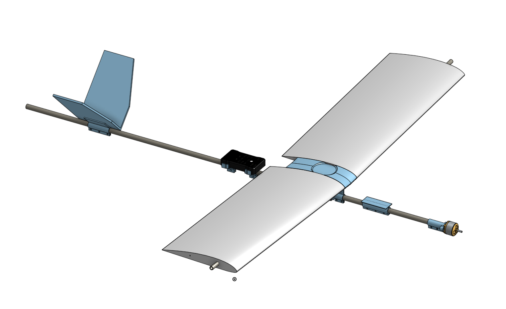
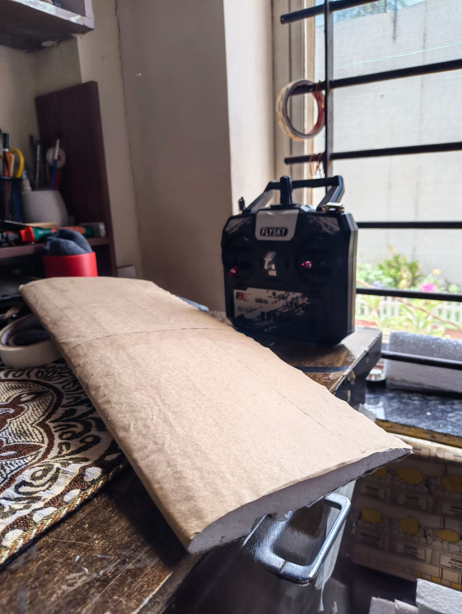

# Long Range Endurance UAV

This is a long-endurance autonomous fixed-wing UAV designed for lightweight package delivery and remote logistics missions.

The project focuses on creating a low-cost, energy-efficient and open-source aircraft capable of autonomous waypoint navigation, payload deployment, and extended flight durations using commercially available components and a custom-built airframe.

## Design Preview

## Flight Videos

- https://youtu.be/uD8uRdXo4Jk
- https://youtu.be/xHYlskcMfM4

### Airframe Concept

### Wiring Diagram

.png)

### CG Location and Mounting Position for the Electronics

Around 24% from the leading edge of the wing (adjust to your preference as the aircraft flies in a SLIGHT high alpha configuration).

## CAD Model

The complete CAD model is available on **[Onshape](https://cad.onshape.com/documents/070acc097ebceafcdfc137a5/w/f8d1af4c79a51be63d857fcd/e/c77c7fed639eaf5160c86485?renderMode=0&uiState=6aef3ea7f58f2f8d61835ab1)**.

## Key Features

- Autonomous flight using ArduPilot
- Pixhawk-based navigation and control
- Long-endurance Li-ion power system
- Lightweight foam-composite airframe (Sub 600g)
- 3.5A cruise at 45kmph
- Payload delivery mechanism
- Modular and repairable design

## 3D Prints

- Print out 1x rib template.
- Print 1 vtail holder.
- Print 1 AirfoilTemplates (not the one that has servo horns in it).
- Print wing mount arms (both of them).
- Print 2 pixhawk holders.
- Print out 1 Better_Servo_link.3mf file (it contains 8 control horns, way more than what we might need).
- Print 1 motor mount in PETG or ABS (PLA shouldnt be used as motor heat melts the motor and it yeets itself off).

## Hardware

### Flight Control

- Pixhawk 2.4.8
- uBlox Neo M8N GPS + Compass
- Simplifly SIK radio
- Flysky reciever

### Propulsion

- 1× A2212 1000KV Brushless Motors
- 1× 30A ESCs
- 10×4.5 Propellers

### Power System

- 4S2P (or more) 18650 Li-ion Battery Pack

## Status

The design build and testing has all been done and aircraft has been optimized for endurance, it currently cruises at 3.5A at 40kmph.

---

## Wing Build Process

1. Print the 3d printed templates in the CAD folder.
2. Put them over a piece of cardboard and cut them out.
3. Use CA glue to reinforce the cardboard and stiffen it up.
4. Take a 18x45x3cm piece of thermocol and on the 18cm side place the 2 templates you just cut out with nails or pins.
5. Wrap nichrome wire around 2 nails with approx 50cm distance between them, attach the power wires on nails and power it using a powersupply (i used my old laptops 19V 2.5A supply).
6. Slowly cut out the 45cm wing section out of the thermocol, dont worry if u dont nail it first try.
7. Repeat this 4 more times to get total wing length of 225cm.
8. Join all the wing pieces together as shown in the assembly.
9. Use the 2m furniture stick to use as a wingspar, hotglue it under the wing where the cavity for it is, make sure it fits flush with the wing, if it doesnt, edit the wing template to fit your spar, the step files for the wing templates have been provided.
10. Now cut your paper bag in approx 22.5cm sections.
11. Cover a part of your wing with the mixture of craft glue + water and then place your piece of paper over it, make sure there are no airbubbles under the wing, do this for all around the wing.
12. Cut strips of 5cm and place it on the seams of the paper you laid down before.
13. Wait for your wing to completely dry before moving on.
14. Cut out alerons from both sides and make them 60 x 5 cm from both sides, dont cut the alerons completely, leave some paper at top part where it can flex.
15. Cut a 50 degree chunk out of the aleron so it can go up and down.
16. Cut out a slot for your servo and place it in with hotglue (remember to center it beforehand).
17. Twist the stainless steel wire to create a pushrod and attach the 3d printed better control horn on the aleron.
18. Put the pushrod wire through the assembly.
19. Cut a slit for the wire out and bring both wires to the middle (use jumper wires to extend the length of servo wires).
20. Put transpaarent packaging tape over your entire wing to smooth it out to reduce friction drag (optional).
21. Cut out motor mounts out of depron and 3d print the motormount plate aswell.
22. Attach them under the wing and route the wires to middle of the wing.

Your wing is done it should look something like this:

---

## Fuselage Build Process

1. Print out the fuselage templates.
2. Use Depron sheets to cut out the fuselage templates (remember to cut out circles on top of it that fit the size of your wingspar).
3. Make a 60cm tube around the templates.
4. Make a simple nose ends for the tube that you just made for aerodynamics, you can experiment here by adding a canopy for fpv, your mind is the bottleneck here.
5. Make a payload box out of depron as shwon in the image of the cad file, cut out the depron tube to fit that box rougly under the place of CG.
6. Before attaching, attach 2 servos inside the bay to open and close the door, wire these 2 servos together and leave it for now.
7. Cut out a hatch from the top of the nose to acess the electronics inside later.
8. Slide in the carbon spar from behind and hotglue it in place, make sure to leavev an inch free inside the fuselage.
9. Put skewers through side of the fuselage to attach the wing.

---

## Battery

Make the battery out of Li ion cells in a 4s2p configuration using spot welding, also solder the BMS to it for charging, and make sure to solder 2 XT 60 connectors to the ends of the battery (NOT THROUGH THE BMS!!!), use long zipties to attach the battery to the tailboom carbon rod.

---

## Elevons and Rudder

1. Cut the exact size sections out of depron as shown in the CAD model (Or you can use your own tail just keep in mind to keep the tail area enough).
2. Attach servo motors each in one of the control surface and wire them to the pixhawk.

Your aircraft frame is ready to fly, go out and test it out before adding autopilot to it.

---

## Autopilot

1. Flash your pixhawk with arduplane 4.7.0 (or above).
2. Configure your transmitter to communicate with the fc.
3. Load the BRK-02 param file in arduplane full parameter list and it will load all the pids and my configuration with the craft.
